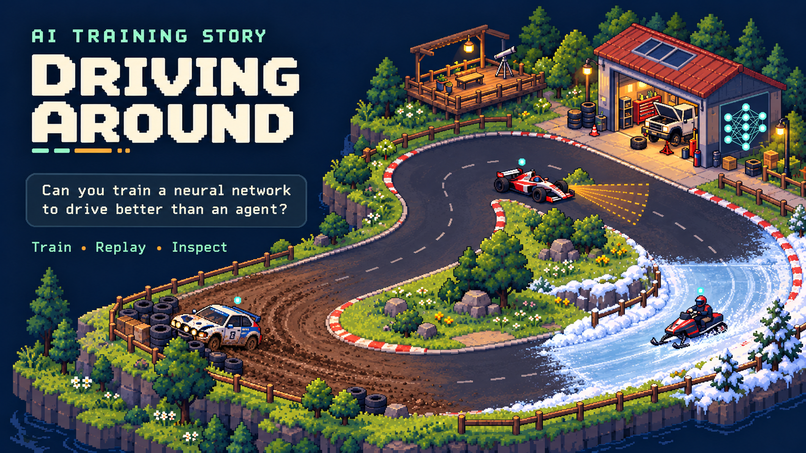
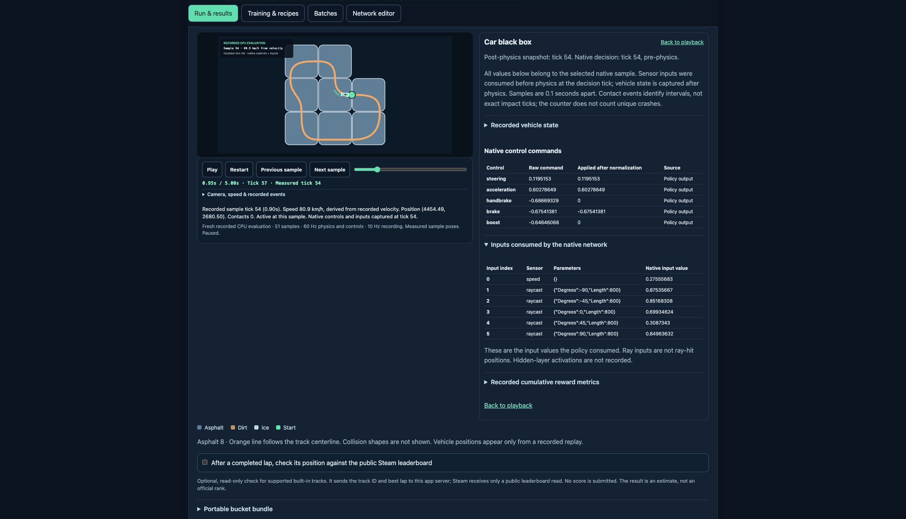

<a id="ald-training-lab-release"></a>
<a id="ai-coaching-story-driving-grounds"></a>
<div align="center">

<h1>AI Training Story: Driving Around</h1>

<p><strong>Can you train a neural network to drive better than an agent?</strong></p>

<p>Train a driver. Replay its decisions. Keep the evidence.</p>

<p>A browser-based controller workshop inspired by <em>AI Learns To Drive</em>.</p>

<p>
  <a href="https://tiga-rce-ald-tao-gpu.hf.space/"><strong>Open Driving Around →</strong></a>
  &nbsp; · &nbsp;
  <a href="#start-with-one-run">Quick start</a>
  &nbsp; · &nbsp;
  <a href="#let-an-agent-run-the-experiment">Agent guide</a>
  &nbsp; · &nbsp;
  <a href="https://github.com/seeker-cyber-maker/driving_sim_rs/releases/tag/ald-lab-2026.10.23">Source &amp; downloads</a>
</p>

<p><kbd>28 replica tracks</kbd> &nbsp; <kbd>4 vehicle types</kbd> &nbsp; <kbd>CPU without sign-in</kbd> &nbsp; <kbd>Optional ZeroGPU</kbd></p>

</div>



*AI-generated editorial concept art. The miniature campus shows four vehicle types, mixed surfaces and a training mishap; it is not a screenshot or a claim of repair, garage, campaign or progression mechanics. The current app uses a functional experiment workspace and dot-style replay.*

[Full-size artwork](docs/media/driving-around-hero.png) · [Thumbnail / social preview](docs/media/driving-around-thumbnail.jpg) · [Image provenance and prompts](docs/media/ASSETS.md)

## More than a lap time

A faster lap tells you that something improved. It does not tell you which controller produced it, what changed during training, or whether the same driver can repeat it.

Driving Around brings controller editing, evolutionary population training, frozen evaluation, reusable recipes and measured driving replay into one workflow. Create a driver or bring a compatible `.evolution` file, run a bounded experiment, then inspect and save the result.

| Build a driver | Run an experiment | Inspect the drive |
| --- | --- | --- |
| Start in the browser or import a controller. Choose sensors, layers and supported outputs. | Evaluate unchanged weights or evolve candidates. Adjust rewards, mutation, freezing and recipes. | Record a native drive, step through measured samples, and compare controls with the inputs the network used. |

No original-game installation is needed for the built-in replica tracks and browser editor. This is a standalone experimental companion, with its own branding, separate from the original game and its campaign. You train the driving neural network directly: choose its architecture, reward settings and experiments, then measure its driving. An agent can help operate these tools and inspect results. The opening question invites a matched comparison against a declared agent baseline; there is no built-in agent-driving benchmark or demonstrated superiority claim.

## Start with one run

1. **Choose a track.** [Open Driving Around](https://tiga-rce-ald-tao-gpu.hf.space/) and select a built-in replica, such as **Replica A01 Beginner**, or upload a compatible `.track` file.
2. **Choose a driver.** Click **Create starter network**, use the **Network editor**, or import a compatible `.evolution`. Imported drivers retain their vehicle type. Keep your original network as the baseline.
3. **Choose the question.** Use **Frozen evaluation** to measure a driver without changing its weights, or **Train a population** to evolve candidates. Review **Training & recipes** before starting.
4. **Run on CPU first.** CPU does not require Hugging Face sign-in or consume GPU allowance. For GPU runs, sign in before selecting files and check the current allowance.
5. **Receive and inspect the result.** Save the driver, analysis archive and receipt from **Latest run**. Select a driver, record a five- or fifteen-second CPU drive, and inspect its replay and black box.

For a small workflow check, use **8 candidates × 3 generations × 900 ticks**, with **60 decisions per second**. This is a compact operating check, not an optimal training recipe or a promise of a clean lap. The app also provides a larger, explicit first-run preset.

[Full usage guide →](docs/HF_LAB.md)

## Train with a purpose

The training tools expose the choices that shape a driver: up to 14 reward metrics, evolutionary settings, selective freezing, saved recipes and batches. Ask a specific question, such as whether a reward change improves distance, lap time or clean driving.

Training changes candidate controllers. Frozen evaluation measures one controller with unchanged weights. Compare candidates under matching tracks, timing and evaluation conditions.

| Result role | What it means |
| --- | --- |
| Fitness winner | The final generation's winner under the selected reward settings. |
| Fastest completed lap | A controller selected for its completed-lap result. |
| Clean-lap controller | A controller meeting the clean-lap condition, when one qualifies. |

One controller may fill several roles; unavailable roles are labeled. Population-relative ranks are not absolute scores that can be compared across unrelated runs.

[Winner selection and evaluation rules →](hf-space/WINNERS_AND_EVALUATION.md)

## Open the car’s black box

Record the selected policy, then play, pause, scrub or step through native samples. Inspect measured motion, contacts, boost, raw and applied control commands, and the sensor vector consumed at the recorded decision tick. Download the recording and reopen it without another simulation.

The recorder runs physics and decisions at **60 Hz** and stores snapshots at tick 1, every sixth tick and the requested endpoint. Optional pose smoothing changes display interpolation only; sensor and control measurements remain attached to recorded samples.

> [!IMPORTANT]
> A recording is a fresh native **CPU evaluation** of the selected, unchanged policy, including a policy trained on GPU. It is not automatically the trajectory from its winning training generation. The track-layout preview is separate from recorded driving replay.

Hidden-layer activations and ray-hit positions are not recorded. Contact events identify sampled intervals, not necessarily an exact impact tick or a unique crash.

<details>
<summary><strong>See the actual native replay and car black box</strong></summary>



Historical interface capture from the qualified pre-rename build, using a disposable Formula fixture. The branding has changed; the measured replay and black-box workflow remain the same.

</details>

[Replay format, capture phases and limits →](hf-space/REPLAY_BLACKBOX.md)

## Let an agent run the experiment

The portable **ald-run-experiment** skill gives an agent a bounded workflow: discover the app’s current actions, preserve the baseline, check GPU allowance before using it, collect result artifacts and inspect a measured replay.

[Read the skill](skills/ald-run-experiment/SKILL.md) · [Download the standalone skill](https://github.com/seeker-cyber-maker/driving_sim_rs/releases/download/ald-lab-2026.10.23/ald-run-experiment-2026.10.23.zip)

```text
Use $ald-run-experiment on AI Training Story: Driving Around.
Run one bounded CPU experiment on Replica A01 Beginner.
Keep my input driver as the baseline and use 60 Hz decisions.
Save the driver, analysis archive and run receipt.
Inspect a five-second native replay.
Do not replace the baseline unless the candidate passes my stated driving gates.
```

The skill is portable across computers and agent accounts. It uses discoverable actions for supported inspection and navigation, and normal visible controls for runs, downloads and account operations. It does not grant credentials or authorize paid GPU overage.

## Keep the result, not just the score

Save the driver, full analysis and run receipt together. Recordings, player reports and generation history add context for comparison or investigation.

Recipes and batches are saved in your browser by default. Optional storage uses an existing private Hugging Face bucket. A bucket connection is not required to train.

> [!NOTE]
> Input files remain in the browser until a run or an explicit export/save action sends or includes them. Processing copies are temporary. Default result delivery deletes the server copy after browser receipt verification, and results expire within five minutes. This describes application retention, not provider-wide zero retention.

Bucket authorization requests Hugging Face’s broad `write-repos` OAuth permission. Read the scope before connecting. GPU account sign-in and optional bucket access serve different purposes.

[Data handling](hf-space/DATA_POLICY.md) · [Bucket storage](hf-space/STORAGE_BOUNDARY.md)

<details>
<summary><strong>Supported vehicles and network limits</strong></summary>

| Vehicle | Maximum outputs | Important restriction |
| --- | --- | --- |
| Formula | 5 | New starters require Steering and Acceleration; supported imported output subsets are retained. |
| Rally | 5 | Steering and Acceleration required. |
| Snowmobile | 4 | Steering and Acceleration required; no Handbrake output. |
| Truck | 5 | Steering and Acceleration required. |

The packaged worker supports up to **20 inputs** (13 raycasts plus 7 other sensors), **12 total layers**, and **16 neurons per hidden layer**. Imported networks must satisfy vehicle-specific ordering and interface rules.

[Track scope and provenance](hf-space/TRACK_LIBRARY.md) · [Package README](hf-space/README.md)

</details>

<details>
<summary><strong>Run the published package locally</strong></summary>

Download `ald-lab-2026.10.23-hf-space.tar.gz` from the [release page](https://github.com/seeker-cyber-maker/driving_sim_rs/releases/tag/ald-lab-2026.10.23), extract it, and follow the included guide. That immutable release preserves the pre-rename build and its checksums. The current GitHub `main` and hosted app use the Driving Around branding.

From the extracted package root, verify the snapshot:

```sh
python3 scripts/verify_hf_snapshot.py
```

The verifier checks bytes and build identity without starting training. On compatible Linux x86-64 with the pinned dependencies installed, the CPU entrypoint is:

```sh
cd hf-space
python3 app_release.py
```

The app starts on port 7860. Bundled native artifacts are Linux applications. Hosted GPU execution additionally needs the provider’s ZeroGPU configuration and OAuth setup. The source snapshot does not provide credentials.

[Hosting and platform guide →](docs/HF_LAB.md)

</details>

<details>
<summary><strong>What the 2026.10.23 release actually checks</strong></summary>

The published qualification covers **12 CPU frozen evaluations, 12 native recordings, 4 GPU frozen evaluations and 4 short GPU training runs** across Formula, Rally, Snowmobile and Truck. The four frozen CPU/GPU comparisons matched their full measurement descriptors exactly in those fixtures.

Test tracks were Replica A01 Beginner, A05 Two Terrains and A06 Ice. Evaluation used 900 configured ticks at 60 Hz decisions. Short training used eight cars, three generations and 900 ticks per generation.

This is finite workflow qualification with disposable synthetic controllers. It does not establish clean laps, superior learning, exhaustive coverage or original-game physics parity. Supported challenge checks are predictions on reconstructed tracks; they do not award official stars or cover every opponent race.

| Identity | Published value |
| --- | --- |
| Original release | `ald-lab-2026.10.23` |
| Original HF revision | `6556847acbf7c98dce628615ece854bbcdec2000` |
| Source snapshot | 100 files under `hf-space/` |
| Current branded build | See the [current source record](docs/HF_SOURCE.json). |

[Release notes](docs/releases/ald-lab-2026.10.23/RELEASE_NOTES.md) · [Qualification record](docs/releases/ald-lab-2026.10.23/verification.json) · [Original source identity](docs/releases/ald-lab-2026.10.23/SOURCE.json)

</details>

## Source, credit and scope

The companion source lives in [hf-space/](hf-space/). Its custom native snapshot is distinct from this repository’s root Rust simulator tree. Use the hosted build identity for comparisons.

Built on [Zorro909’s driving_sim_rs](https://github.com/Zorro909/driving_sim_rs), with TiGa’s hosted interface, bounded worker integration and native replay/black-box additions. Inspired by [AI Learns To Drive by ActivationFunction](https://store.steampowered.com/app/3312030/AI_Learns_To_Drive/). The package records upstream base `b90b8af06ffc4ea4e4fd703becd1107a48b8e5e0` and subsequent changes.

The package retains the upstream MIT licence, Godot notice and dependency notices. These do not license unrelated original-game content or private tracks and networks.

## Report a reproducible issue

Include the app build, vehicle, track identity, CPU/GPU route, physics and decision timing, settings, and the smallest shareable result demonstrating the problem. Keep measured results separate from expectations.

[Open an issue draft →](https://github.com/seeker-cyber-maker/driving_sim_rs/issues/new)

Do not post access tokens, job keys, private networks, proprietary tracks or unrelated logs.

<div align="center">
<p><strong>Change the training. Measure the driving. Preserve what you learned.</strong></p>
<p><a href="https://tiga-rce-ald-tao-gpu.hf.space/">Open AI Training Story: Driving Around →</a></p>
</div>

<details>
<summary><strong>Root Rust simulator and upstream CLI guide</strong></summary>

[](https://github.com/Zorro909/driving_sim_rs/actions/workflows/ci.yml)

`altd-sim` is a Rust vehicle simulator and neural-network trainer for AI Learns To Drive. It runs headless on the CPU, through a runtime-loaded AMD HIP library, or in WebAssembly. It reproduces the game's floating-point arithmetic, contact ordering, sensors and evolution behavior against captured regression fixtures. Exactness claims apply to the tested inputs; [fidelity](docs/fidelity.md) records the limits.

The repository includes vehicle and sensor templates, tile resources, fixed generated tracks and self-contained tests. Campaign tracks are not distributed.

## Getting started

This guide sets up `altd-sim serve`, the local simulator for [Drive Lab](https://drivinglab.jectrum.de). Drive Lab keeps your tracks, runs and downloads in the browser; the server drives the cars on your CPU threads or an AMD GPU. That removes the browser's limits on cars and network size and its eight-thread cap.

### 1. Download

Download the archive for your system from [Releases](https://github.com/Zorro909/driving_sim_rs/releases). Tagged versions are stable; the `nightly` pre-release is rebuilt from every push to `main` and keeps the same file names. `SHA256SUMS` lists the archive checksums.

| System | Archive | Training on |
| --- | --- | --- |
| Linux x86_64 | `altd-sim-<version>-x86_64-unknown-linux-gnu.tar.gz` | CPU, or AMD GPU through HIP |
| Windows x86_64 | `altd-sim-<version>-x86_64-pc-windows-msvc.zip` | CPU |
| macOS, Apple silicon | `altd-sim-<version>-aarch64-apple-darwin.tar.gz` | CPU |

Unpack it and open a terminal in the unpacked folder:

```sh
tar -xzf altd-sim-nightly-x86_64-unknown-linux-gnu.tar.gz
cd altd-sim-nightly-x86_64-unknown-linux-gnu
./altd-sim --version
```

On Windows, extract the `.zip`, then open PowerShell in the folder and use `.\altd-sim.exe` wherever this guide says `./altd-sim`. macOS binaries are unsigned, so first remove the download quarantine with `xattr -d com.apple.quarantine altd-sim`. Apple silicon uses the portable trigonometry described in [fidelity](docs/fidelity.md).

### 2. Start the server

```sh
./altd-sim serve
```

```text
altd-sim serve: listening on ws://127.0.0.1:47800/v1
  allowed origins: https://drivinglab.jectrum.de
  CPU threads: 16
  HIP: available (AMD Radeon RX 7900 XTX)
```

Keep the terminal open while you train; <kbd>Ctrl</kbd>+<kbd>C</kbd> stops the server. It listens only on `127.0.0.1`, so the browser must run on the same computer.

### 3. Connect Drive Lab

1. In Drive Lab, open **New run**. Under **Compute**, enable **Use a local altd-sim**. The port field defaults to 47800.
2. If the browser asks to allow access to devices on your local network, allow it.
3. The status shows the connection, the CPU thread count and the GPU, if HIP is available. Choose **Native CPU** or **Native GPU (HIP)** and start the run.

Each browser connection gets its own session. Only one session at a time can use the GPU; another one asking for HIP trains on CPU and says why. If the server stops during training, the run stops and keeps its last saved generation. Start the server again and resume the run.

### Options

| Option | Use it to |
| --- | --- |
| `--threads N` | Limit the CPU threads, for example to keep the computer responsive. The default is every logical CPU the process may use. |
| `--port N` | Listen on another port when 47800 is taken. Set the same port in Drive Lab. |
| `--allow-origin ORIGIN` | Allow another Drive Lab address, such as a development copy: `--allow-origin http://127.0.0.1:5173`. It replaces the default; repeat the option to allow several. |

```sh
./altd-sim serve --threads 8 --port 47801
```

### Training on an AMD GPU

The Linux archive contains `libaltd_gpu.so` next to `altd-sim`. It needs a ROCm 7.x runtime and one of the [covered GPU architectures](gpu/README.md). `./altd-sim gpu-info` checks that the library loads and prints `"layout": "ok"`; the server's `HIP:` line shows the device or why HIP is unavailable.

A HIP session drives its first 12 ticks on both the GPU and the CPU and compares them. If they differ, or the network or track needs something HIP does not support, the session trains on CPU and Drive Lab shows the reason. Native CPU and HIP produce the same results. Browser training can differ from both in the last digits of a few values ([issue #3](https://github.com/Zorro909/driving_sim_rs/issues/3)), so a run moved between the browser and the server can develop differently from then on.

### Troubleshooting

- **`cannot listen on 127.0.0.1:47800: Address already in use`**: another server is already running, or another program uses the port. Stop it or choose another `--port`.
- **Drive Lab cannot connect**: check that the server is running and that both use the same port. A Drive Lab address other than `https://drivinglab.jectrum.de` must be allowed with `--allow-origin`, including its scheme and port. If you denied local network access, allow it again in the browser's site settings.
- **`HIP: unavailable`**: the line gives the reason. `./altd-sim gpu-info` reports library problems, and [GPU setup](gpu/README.md) covers ROCm and other GPU architectures.

[Server documentation](docs/server.md) describes the protocol and its security checks for other clients.

### Training without Drive Lab

The CLI can also train on its own. This example trains Rally networks on generated tracks and writes them to `runs/example`:

```sh
./altd-sim train-scratch --scene assets/scenes/rally_template.json --track-mode random \
  --random-track-settings assets/random_track_settings.json \
  --population 256 --generations 3 --ticks 600 --out-dir runs/example
```

Add `--gpu` to train on an AMD GPU. `./altd-sim --help` lists every command, and the [CLI reference](docs/cli.md) describes their inputs and outputs.

## Build from source

Rust 1.94 or newer is the tested native toolchain. Build from the repository root. `--offline` works when dependencies are already cached; omit it on the first build if needed.

```sh
cargo build --release --offline
python3 tools/benchmark.py --population 1024 --ticks 600 --repeats 5 \
  --report target/benchmark.json

target/release/altd-sim --threads 8 train-scratch \
  --scene assets/scenes/rally_template.json --track-mode random \
  --random-track-settings assets/random_track_settings.json \
  --population 256 --generations 3 --ticks 600 --seed 1729 \
  --eliminate-on-wall --idle-eliminate --save-final-candidate \
  --out-dir runs/example
```

The training command starts Xavier networks and generates a reproducible track each generation. Increase the population, generations and tick limit for longer runs. Supply the same scene and track settings when resuming, with `--resume` and a higher `--generations` target.

`.cargo/config.toml` uses `target-cpu=native` for x86 local builds, including the published CPU measurements. For a portable x86_64 binary, override it explicitly:

```sh
RUSTFLAGS='-C target-cpu=x86-64' cargo build --release --offline
```

AVX2 network and geometry paths use runtime detection and retain scalar fallbacks. Exact native trigonometry uses x87 on x86; other targets use the portable implementation described in the fidelity notes.

## Other backends

AMD GPU builds need ROCm and `hipcc`. The default architecture is `gfx1100`, for the RX 7900 XTX.

```sh
gpu/build.sh
# Add --gpu to the train-scratch command above.
```

For other AMD GPUs, set `GPU_ARCH` to one or more architectures when building. Rust builds do not require ROCm. See [GPU setup](gpu/README.md) for validation and profiling.

The default build also includes a local WebSocket server for native CPU or HIP sessions:

```sh
target/release/altd-sim --threads 8 serve
```

[Getting started](#getting-started) explains its options and how to connect Drive Lab; [server documentation](docs/server.md) covers the protocol, security checks and checkpoint resume.

WebAssembly builds need the wasm32 target and the matching `wasm-bindgen` CLI:

```sh
rustup target add wasm32-unknown-unknown
cargo install wasm-bindgen-cli --version "$(wasm/bindgen-version.sh)" --locked
wasm/build.sh
```

The JavaScript library includes CPU simulation, a threaded CPU package and optional WebGPU backends. See [WASM setup](wasm/README.md) for initialization, browser requirements and tests. Expanded native/WASM comparisons have known last-bit differences; serial and threaded WASM are compared separately.

## CLI and output

`target/release/altd-sim --help` and `target/release/altd-sim COMMAND --help` show arguments. `bench` measures a fixed population; `train` evolves an exported network; `train-scratch` starts Xavier networks and supports checkpoints, generated-track batches and stop conditions; `evaluate` runs a frozen candidate against a hash-validated suite; `serve` exposes sessions over a loopback WebSocket. The `compare-*` commands compare user-supplied captures with the simulator. Scenes and recorded traces are explicit inputs. [CLI reference](docs/cli.md) covers defaults, resume behavior and report formats.

A `train-scratch` run writes:

| File | Contents |
| --- | --- |
| `run.json`, `log.jsonl`, `progress.json` | Effective options, completed generations and current progress |
| `checkpoint.json`, `checkpoint_gNNNNN.bin` | Generation-boundary population and RNG state |
| `best.json`, `best_laps/` | Networks that set a new best lap |
| `candidate.json` | Final fitness leader when `--save-final-candidate` is enabled |
| `tracks/` | Generated track geometry for replay |

## Code and tests

`src/math/` contains runtime-compatible arithmetic and vectors. `src/physics/` implements vehicles and contacts, while `src/track/` owns scene geometry, spatial queries and generated tracks. `src/nn/` provides scalar and AVX2 inference. `src/training/` owns populations, evolution, RNGs, evaluation and embedding sessions. `src/gpu/hip.rs` loads HIP; `src/gpu/simulation.rs` shares device layouts with `src/wasm/`, which supplies JavaScript and WebGPU bindings. The CLI entrypoint is `src/bin/altd-sim/main.rs`, beside its argument, comparison, benchmark and checkpoint modules. Rust imports follow these groups, such as `altd_sim::physics::car::Car` and `altd_sim::training::session::Session`. See [design notes](docs/design.md).

```sh
cargo test --release --offline
cargo test --offline
cargo build --offline --target wasm32-unknown-unknown --no-default-features --features wasm
```

Tests retain self-contained native captures and label generated golden data as current-code regressions. Browser integration checks live in `wasm/test/`; HIP equivalence checks use `gpu_check`. The exhaustive trigonometry scan and hardware-dependent tests are opt-in. See [performance](docs/performance.md), [GPU internals](docs/gpu.md) and [WASM fidelity](docs/wasm.md).

GitHub Actions checks formatting, native and WASM Clippy, native release and debug tests, Windows and macOS Clippy and release tests, the HIP library build and layout, rustdoc, Rust 1.93 compatibility, and WASM packages with CPU browser comparisons. The release workflow builds and smoke-tests the archives, then publishes tags and nightly builds. Its native jobs override `target-cpu=native` with `x86-64` and include the flags in their cache keys, so cached builds can move between runner CPUs. Serial/threaded browser tests retain the documented expanded native differences. HIP equivalence and hardware WebGPU checks run separately because the hosted runners have no GPU.

The project uses the [MIT license](LICENSE). Godot-derived code retains the [Godot notice](GODOT_LICENSE), and numerical modules retain their source notices.

</details>
