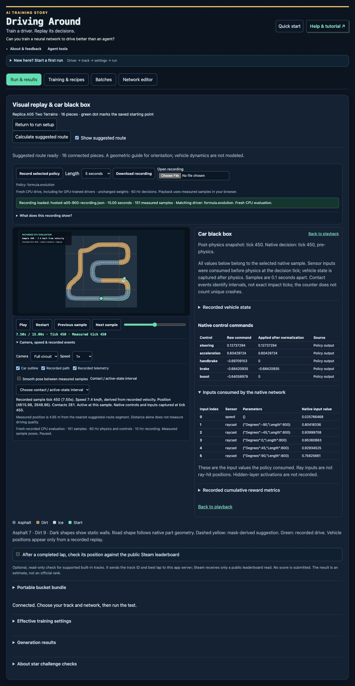

# Native-mask map preview — 2026-10-24

AI Training Story: Driving Around now draws the preview road from the native track parts’ collision geometry. The existing Hugging Face Space and source are public: https://huggingface.co/spaces/TiGa-RCE/ald-tao-gpu. Open the app at https://tiga-rce-ald-tao-gpu.hf.space/.

## What changed

- Road shapes and static obstacles come from the native part polygons, including split lanes, dividers and posts.
- **Calculate suggested route** adds an optional dashed yellow guide for general orientation. It follows real openings between neighboring pieces and the saved track order.
- The green **Recorded path** is the car’s measured native trajectory. Route and recorded-path visibility are independently controlled.
- Playback, scrubbing, sample stepping, native controls and consumed sensor inputs remain attached to the recording. Download and reopen a recording without another simulation.
- The current source snapshot also catches GitHub up to the already deployed driver-first interface and enforced **batch_count=1, 60 Hz physics and decisions**. Historical recipes remain readable and can be copied to 60 Hz.
- Thirteen backed-up stale Python3.13 bytecode files were removed from the HF repository; only declared product files plus .gitattributes remain.

The suggested route is a geometric reference. It is not an optimal racing line, a driving-quality score or a guarantee that a vehicle can follow it. No policy was promoted.

## Fresh verification

- All 28 built-in tracks generated a guide; an independent native-polygon audit passed all 15,951 final segments.
- Independent mask checks covered 151 distinct part geometries and 312,816 free cells, with zero wall intersections.
- Ten focused properties and actual served bootstrap checks passed, including 14 inline scripts and mask-before-map delivery.
- On this exact hosted build, fresh native CPU recordings passed at 5 seconds / 51 measured samples and 15 seconds / 151 measured samples, with 60 Hz physics/decisions and verified unchanged policy weights.
- Browser checks passed route calculation, play/pause, scrub to tick 450, next sample 456 / previous 450, native controls/sensor tick binding, independent route/path toggles, recording download and reopen. The downloaded recording’s JSON equals the native response. No console errors were observed.
- Anonymous HF metadata, Space page, exact source file and live app reads passed after making the Space public.
- Current GitHub source is 102 product files, with 101 release-manifest members. Run `python3 scripts/verify_hf_snapshot.py` from the repository root to verify bytes and build identity.

This is a preview/UI release. It does not claim new learning gains or rerun the full CPU/GPU driving qualification. No GPU call or paid hardware was used. The native binaries, worker/training behavior, OAuth scope and private-bucket behavior are unchanged. Godot and Swift received no edits; the retained parent remains unchanged. The original `ald-lab-2026.10.23` tag and release assets are preserved.

## Identity

- HF revision: `8994edc1950e5a1289ddad1795319206acca1f1f`
- Build: `ald-winners-2a41891ca1dbf3341b9f64323debc4c0edc63ef62b3bb918f8d01d89fe18741a`
- Previous HF revision for rollback: `a948328ba845076e6dd2767ff0767039a30a0788`
- [Current source record](../../HF_SOURCE.json)
- [Bounded verification record](verification.json)

The screenshot uses a disposable synthetic Formula fixture on Replica A05 Two Terrains. It illustrates inspection and is not a clean-lap or driving-performance result.
